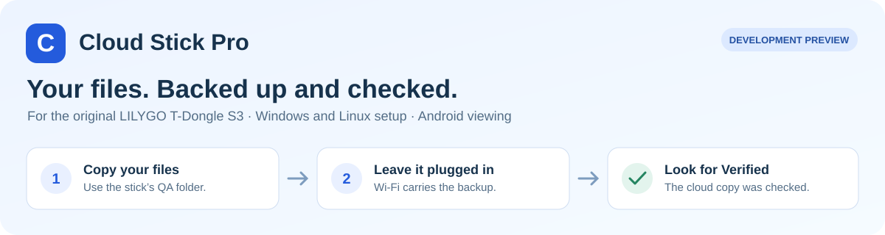
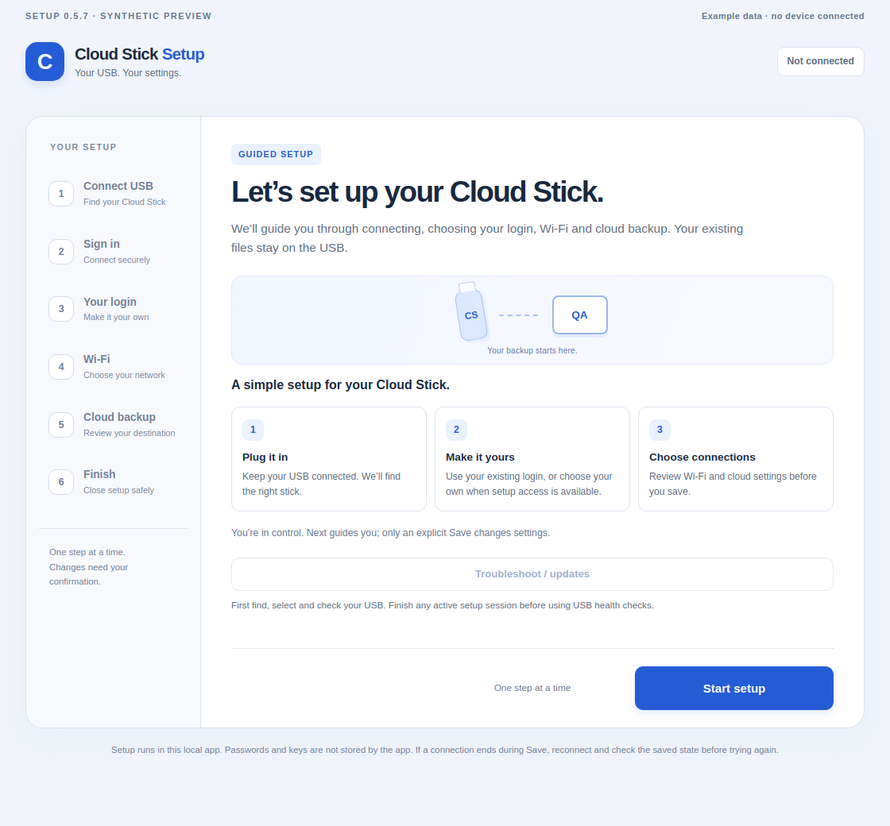
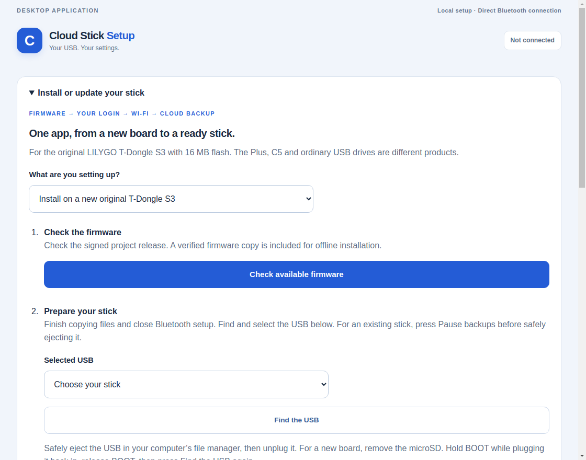
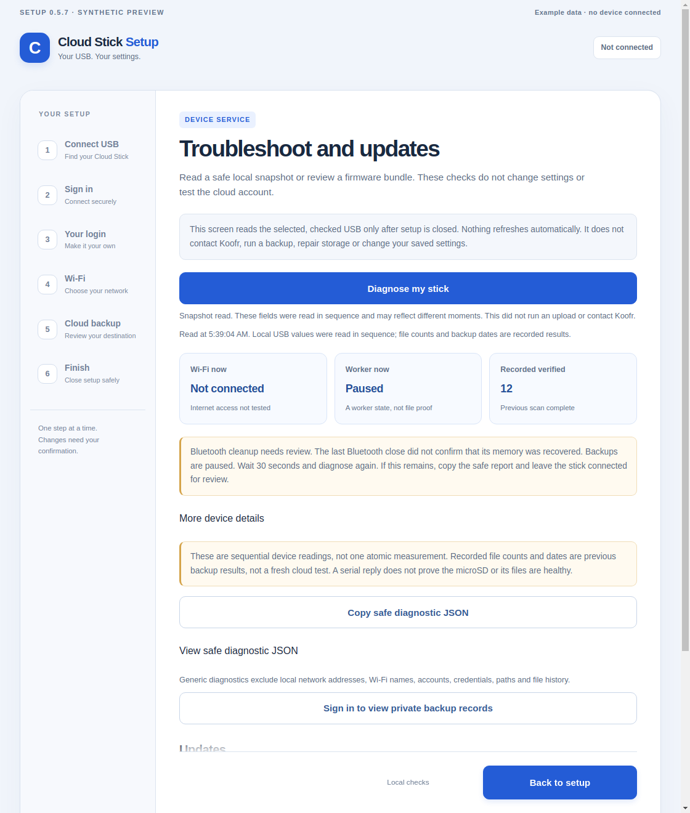
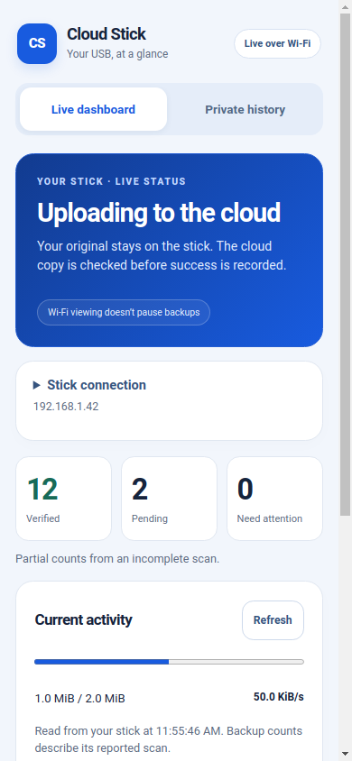
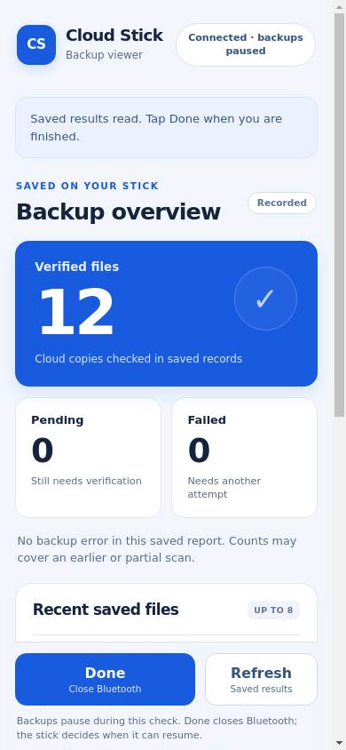
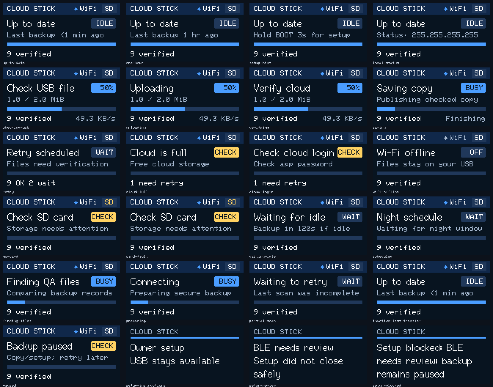

# Cloud Stick Pro

Copy files to your supported USB stick and leave it plugged in. Cloud Stick Pro
uses Wi-Fi to back them up to the cloud, checks the cloud copy, and records the
result. Your original files stay on the stick.

**Cloud Stick Setup** for Windows and Linux guides firmware installation, your
login, Wi-Fi and cloud settings in one app. **Cloud Stick Viewer** for Android
opens a live Wi-Fi dashboard, with Bluetooth sign-in for private backup history.

Based on [Cloud Stick by John / JMcrafter26](https://github.com/JMcrafter26/cloud-stick).
Original credits and component notices are preserved in [Credits](docs/CREDITS.md).

**This is a development preview for the original LILYGO T-Dongle S3.** First
installation on an unconfigured board and physical Windows USB operation still
need testing. [What has actually been checked](docs/RELEASES.md).

[Start here](docs/GETTING_STARTED.md) · [Help](docs/TROUBLESHOOTING.md) ·
[All guides](docs/README.md) · [What changed](docs/RELEASE_NOTES.md)

## Download the preview

Open the [all-in-one Setup 0.6.0 release](https://github.com/rtariq2015/cloud-stick-pro/releases/tag/preview-2026.11.07-integrated-setup)
and choose **one computer app**:

| Your device | Download | How to start |
| --- | --- | --- |
| Windows 11, 64-bit | [Windows installer](https://github.com/rtariq2015/cloud-stick-pro/releases/download/preview-2026.11.07-integrated-setup/cloud-stick-0.6.0-windows-x86_64-setup.exe) | Open the downloaded installer, then open **Cloud Stick Setup** from Start |
| Ubuntu 24.04, 64-bit, or compatible Linux | [Linux `.deb`](https://github.com/rtariq2015/cloud-stick-pro/releases/download/preview-2026.11.07-integrated-setup/cloud-stick_0.6.0_amd64.deb) | Open it with your package installer, then launch **Cloud Stick Setup** |
| Android 12 or newer, optional viewer | [Android APK](https://github.com/rtariq2015/cloud-stick-pro/releases/download/preview-2026.11.08-android-tested/Cloud-Stick-Viewer-0.2.1.apk) | Open **Cloud Stick Viewer** and add the stick’s IP address |

Portable Windows/Linux alternatives, checksums, source and test records are on
the release page. **Code → Download ZIP** gives project source; the links above
give apps you can install. Read [Updates](docs/UPDATING.md) before replacing an
older copy. The Windows preview is not publisher-signed.

## Start here

You need the **original LILYGO T-Dongle S3** with 16 MB flash and no PSRAM, a
suitable microSD, Wi-Fi and a Koofr account with a separate app password. The S3
Plus, C5 and ordinary USB flash drives are different products.

1. **Open Cloud Stick Setup.** For a new board, choose **Install or update your
   stick** and follow [the installation guide](docs/INTEGRATED_SETUP.md).
2. **Make it yours.** Sign in to an existing stick, or follow **Create my first
   account** when the app offers it. Choose and keep your own login.
3. **Add your connections.** Check and save your Wi-Fi or phone hotspot, then
   review the cloud destination.
4. **Finish setup.** Press **Finish — disconnect Bluetooth**. Follow the microSD
   reminder if you created the first account, then leave power connected. Copy a small test file into `QA`, the default watched folder.
5. **Look for Verified.** Upload completion comes before the cloud-copy check.
   The saved backup result tells you which file version was checked.

The [full getting-started guide](docs/GETTING_STARTED.md) explains each step in
plain language. [Troubleshooting](docs/TROUBLESHOOTING.md) covers Wi-Fi, Bluetooth,
installing a new board and finding the correct app.

## What it does

- **Backs up new or changed files** after copying settles and the saved schedule allows it.
- **Checks cloud contents** before recording a verified backup.
- **Remembers saved Wi-Fi networks** and can try an alternative after disconnection.
- **Keeps setup together**: firmware, login, Wi-Fi and cloud settings in the computer app.
- **Explains local problems** through **Diagnose my stick** and a safe report you can share.
- **Shows results nearby** on the stick, computer, local dashboard or Android viewer.

## A look at the interfaces

These are synthetic previews of the real interfaces, rather than evidence of a
physical device or cloud test.

### Desktop setup

See firmware installation, troubleshooting, Android and the stick display

### Firmware installation

### Diagnose my stick

### Android viewer

Private history stays behind Bluetooth sign-in:

### Dongle display

## Versions and evidence

| Component | Current preview | Evidence and remaining checks |
| --- | --- | --- |
| Computer Setup app | **0.6.0**, Windows and Linux | Native builds, packaged program tests and synthetic window checks; Windows install/launch/uninstall passed in CI |
| Software inside the stick | **0.4.6-cache-dev**, unchanged | Recorded protected updates/closes passed; a later BLE memory-recovery failure remains open. Saved-network switching passed on a separate private image |
| Android Viewer | **0.2.1** | 21 real Pixel/Android 17 checks pass, including Wi-Fi, persistence and authenticated history → Refresh → Done; intermittent firmware cleanup failure remains open |

New-board installation, physical Windows USB operation, the owner's exact phone
**Save Wi-Fi → Finish** sequence, real access-point outages and multi-day endurance
remain separate acceptance work. A native build or screenshot is not a hardware
test. Exact sources and file hashes are in [Release records](docs/RELEASES.md).

## Practical limits

Keep the stick powered while it works. Its default quiet period is two minutes
after USB writes; a saved schedule may delay a backup. Bluetooth setup pauses
backup work, so use Finish when you are done.

The backup inventory tracks 128 file paths; the Android viewer shows up to eight
summaries. Recorded results describe previous checks. Open guest Wi-Fi with a
venue sign-in page remains experimental. Keep important originals until you have
checked your own backup. More answers are in [Troubleshooting](docs/TROUBLESHOOTING.md).

## Build and contribute

[Project map](docs/PROJECT_LAYOUT.md) · [Developer guide](docs/DEVELOPER_GUIDE.md) ·
[Tests](test/README.md) · [Tools](tools/README.md) · [Contributing](CONTRIBUTING.md)

Firmware lives in `src` and `include`, the computer app in `desktop`, and the
phone viewer in `android`. Read [Credits](docs/CREDITS.md) before redistribution:
the upstream README says MIT, but its linked license text is still missing.
No blanket replacement license has been invented. Build profiles, notices,
private-data exclusions and the [review process](docs/MAINTENANCE.md) are retained.
