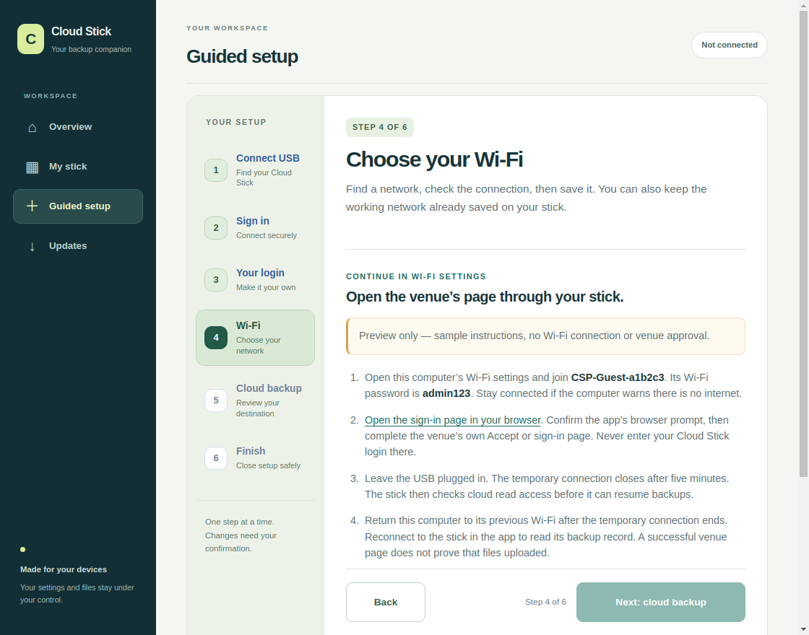

# Cloud Stick Setup for Windows and Linux

**One computer app for firmware, your login, Wi-Fi and cloud setup.**

Development source 0.7.4 fixes the guest sign-in link, explains the laptop
handoff and handles temporary USB discovery races during reconnection. It has not replaced the published 0.7.3 downloads below. Actual venue
sign-in remains a separate connection test.

Use Setup **0.7.3** with the original LILYGO T-Dongle S3, 16 MB flash, no PSRAM.
[Download the preview](../README.md#download-the-preview) ·
[Start here](../docs/GETTING_STARTED.md) · [Help](../docs/TROUBLESHOOTING.md)

## Install and open the app

| Computer | Recommended package | What to do |
| --- | --- | --- |
| Windows 11, 64-bit | `cloud-stick-0.7.3-windows-x86_64-setup.exe` | Open the installer, then choose **Cloud Stick Setup** in Start |
| Ubuntu 24.04, 64-bit, or compatible Linux | `cloud-stick_0.7.3_amd64.deb` | Open it with your package installer, then launch **Cloud Stick Setup** |

The Windows installer installs for your current user. The development preview is
not publisher-signed. The Linux package declares its runtime dependencies and
installs the narrow USB access rule for the active desktop user. Bluetooth needs
a working computer adapter and the normal operating-system permissions.

Portable alternatives are on the release page. Extract the whole ZIP/archive,
then open `cloud-stick/cloud-stick.exe` on Windows or `cloud-stick/cloud-stick`
on Linux. Keep `_internal` and `firmware-helper` beside the program. Source ZIPs
are for developers rather than app installation.

## Set up your stick

For a new original board, open **Install or update your stick**. It checks the
signed firmware release, includes a verified offline copy, makes private recovery
copies and verifies installation. Follow [the one-app guide](../docs/INTEGRATED_SETUP.md)
for BOOT, first-account creation and returning the microSD. New-board physical
acceptance remains pending; an owned stick is not a substitute factory-test board.

For an already configured stick, plug in normally, find/select/check the USB,
then sign in with your current username/password. Review and explicitly save
Wi-Fi/cloud changes. Finish closes Bluetooth; leave power connected for backups.
A newly created first account has its own reminder to return the microSD while
unplugged if the card is still out.

You choose your own login. The app supplies no `admin/admin` account. A previously
trusted Linux computer may offer device-bound remembered setup access; otherwise
use the personal login. Windows recovery-key protection is implemented for the
installer; remembered legacy setup access remains a separate Linux-only facility.

A later compatible firmware can be admitted only through the project's verified
signed catalog. Unknown versions and a local manifest's signature claim do not
grant installation or management access. Firmware that changes the supported
contract requires a newer Setup app.

## Diagnose a problem

### Guest Wi-Fi that asks you to Accept

First check and save a working Wi-Fi connection. If the venue needs a sign-in
page, choose **Help me open the sign-in page**, then **Continue to temporary
Wi-Fi**. Development 0.7.4 explains how to join that temporary connection from
this computer and open the venue page in the usual browser. Return the computer
to its previous Wi-Fi afterward. A phone is optional.



The example above uses sample connection details. It does not prove a venue
approved the stick or that a file uploaded. If the stick cannot obtain a valid
network address, resolve that connection failure before starting sign-in help.

### Local device checks

Close the setup connection, find/select/check the USB and open
**Troubleshoot / updates → Diagnose my stick**. It reads a local snapshot and
explains a useful next step. **Copy safe diagnostic JSON** excludes Wi-Fi names,
accounts, passwords, addresses, paths and file history.

The check does not run a cloud upload or prove the card's files are healthy.
Authenticated records show saved file results separately. Use
[Troubleshooting](../docs/TROUBLESHOOTING.md) if a warning remains.

## Update or remove an older copy

Open **Updates → App updates** to check the signed release, download a checked
package and choose **Install update**. The first check waits for USB/firmware
work to become idle. Windows opens its verified installer; a Linux user install
keeps the old program folder when replacing it. A system `.deb` update uses your
computer's package installer and may need your computer administrator password.
Preferences and private recovery copies are retained. Manual downloads remain
available on the release page.


Wait for any firmware work to finish, then close Setup before changing its
computer installation. Keep one installation type to avoid duplicate menu entries.

- **Windows installer:** install the newer Setup package for the same user.
  Remove it through **Settings → Apps → Installed apps → Cloud Stick Setup**.
- **Linux `.deb`:** use your package installer to update or remove **Cloud Stick
  Setup**. Keep the previous download until the new app opens correctly.
- **Portable folder:** close the app, keep the complete old folder as a backup,
  extract the new one into a different folder and launch its program.

A Linux user-local installation made by `install-user.py` deliberately refuses
an overwrite. To replace it, close the app, keep a copy of its full installation,
run its own uninstaller below as your normal desktop user, then run the new
archive's `install-user.py` from the extracted directory:

```sh
python3 ~/.local/opt/cloud-stick-desktop/uninstall-user.py
python3 install-user.py
```

That uninstaller checks its same-app marker and removes only its application,
launcher and matching menu/icon entries. Private recovery copies/preferences
are retained. Updating/removing the computer app does not erase the card or
replace the stick's login. Firmware changes use the separate explicit install
confirmation inside Setup.

## Portable Linux details

The supported baseline is Ubuntu 24.04 x86-64 / glibc 2.39 or newer compatible
systems. The app includes Python, Qt/WebEngine and Python dependencies; the
computer supplies its graphics libraries, BlueZ/D-Bus and desktop permissions.
The installer also needs a systemd user session with working memory controls.

[Runtime packages](packaging/linux/runtime-packages.txt) are listed explicitly.
The `.deb` adds `70-cloud-stick-pro.rules` under `/usr/lib/udev/rules.d`, reloads
rules and requests a change event without resetting the stick. It uses `uaccess`
for matching Espressif `303a:1001` serial devices, without world-writable access
or broad group changes. The portable user installer does not install system rules.

Run as your normal desktop user with Chromium sandbox support. The application
serves its interface locally, keeps its page profile in memory and asks before
opening external links. Login passwords stay off disk. Firmware recovery copies
are encrypted and retained privately on the computer; preserve them until the
stick is working.

## Source and packaging

Use CPython 3.12 and the pinned [requirements](requirements.txt). From `desktop`:

```sh
python3 -m venv .venv
.venv/bin/python -m pip install -r requirements.txt
.venv/bin/python -m cloudstick_desktop
```

On Windows use `py -3.12` and `.venv\Scripts\python.exe`. The source checkout keeps
the frontend beside the package. The supported distributable format is the
complete native bundle. [Packaging instructions](packaging/README.md) describe
signed offline data, Linux/Windows builds, notices and acceptance.

[Native tests](tests/run_native_tests.py) and `node --test desktop/tests/frontend-*.test.mjs`
run without a stick. The `--smoke-test` mode opens the real window with a synthetic
transport; it does not discover or connect to hardware. Build scripts retain the
Chromium sandbox. Native software checks, physical USB/Bluetooth operation and a
cloud backup are separate results; see [release records](../docs/RELEASES.md).
