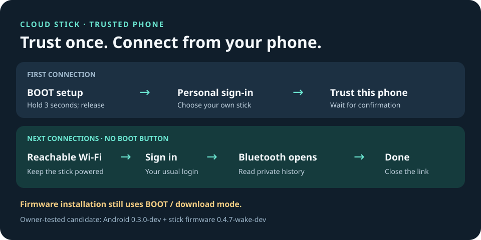

# Connect your trusted phone without BOOT

This guide is for the owner-tested **Viewer 0.3.0-dev / firmware 0.4.7-wake-dev**
candidate. It has passed two real phone-to-stick connections. The public download
links still offer earlier versions until separate package publication.

## Your phone is already trusted

For the owner’s tested phone, setup is complete:

1. Keep the stick powered and both devices on reachable Wi-Fi or your hotspot.
2. Open **Cloud Stick Viewer → Private history**.
3. Enter your personal Cloud Stick username and password.
4. Tap **Sign in & find my stick**. Leave the BOOT option unchecked.
5. Read your saved results. Tap **Done** when finished.

The app asks your trusted stick over Wi-Fi to open Bluetooth, connects to that
specific stick, and checks your login. You do not need to hold BOOT for this
ordinary connection. Bluetooth closes afterward; the stick decides when its
safety checks allow backups to resume. **Live dashboard** shows current public
status without signing in and without pausing backups.

## Trust a phone for the first time

1. Open the stick’s setup window by holding BOOT for three seconds, then release.
2. In Private history, choose **Use BOOT for this connection** and sign in.
3. Choose your own stick from the nearby list.
4. Once signed in, tap **Trust this phone** and wait for confirmation.
5. Tap **Done**. For your next Wi-Fi connection, uncheck the BOOT option.

Only one phone is trusted by this feature. Trusting another phone replaces the
previous one. Changing the stick’s personal login cancels its old phone trust;
sign in using the BOOT route and trust the phone again.

## If it does not connect

- Check that the saved IP address still opens Live dashboard. Update the address
  if the stick’s screen shows a different one.
- Keep Bluetooth enabled and allow **Nearby devices** for the app.
- Let current work finish and retry if the stick is busy. After opening Bluetooth,
  the feature has a short safety cooldown before another opening request.
- If Wi-Fi is unavailable or blocks local device connections, use the BOOT option
  and the ordinary nearby Bluetooth setup window.

An incomplete trust message means both sides have not confirmed the pairing.
Reconnect through BOOT, sign in, and explicitly try **Trust this phone** again.
The app does not automatically repeat a pairing save whose outcome is uncertain.

**Installing firmware is a separate operation.** The current computer installer
still needs BOOT/download mode after safe ejection. Button-free app connections
do not automate firmware installation.

The earlier intermittent **BLE needs review** recovery fault remains open. If it
appears, follow [the recovery guidance](TROUBLESHOOTING.md); a successful phone
sign-in alone does not prove that backups resumed.

[Exact physical tests and limits](releases/2026-11-08-button-free-development.md)
· [Updates](UPDATING.md) · [All guides](README.md)
