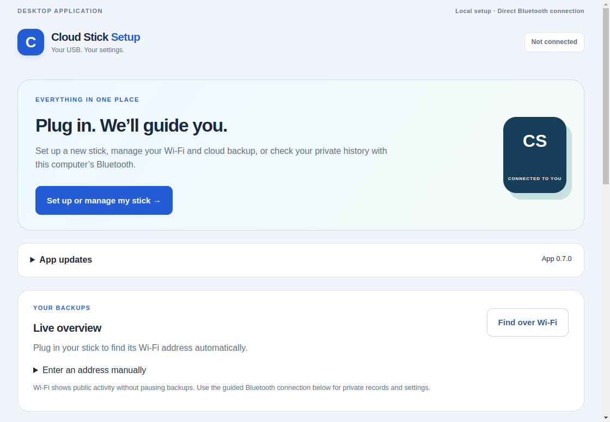

# One companion for your Cloud Stick

Cloud Stick Setup on Windows or Linux can set up and manage your stick without a
phone. The Android app can show live backups, private history, saved Wi-Fi
networks and cloud destination settings.

These improvements are in development: **Setup 0.7.0**, **Android 0.4.0-dev** and
**discovery firmware 0.4.8-discovery-dev**. A source preview is not an installed
update. Check the release's download and test notes before installing.

*Development window with a synthetic transport; no connected-device data.*

## On your computer

1. Open Cloud Stick Setup and plug in the original LILYGO T-Dongle S3.
2. The app notices supported USB connections. With one stick attached, it reads
   its status and Wi-Fi address. With several, choose your stick.
3. Choose **Set up or manage my stick**. The guide takes you through your login,
   Wi-Fi and cloud destination. An existing account is never replaced by guessing
   that a stick is new.
4. For a new board or a firmware update, choose **Install or update your stick**.
   The app checks the signed firmware release. **Use downloaded firmware files**
   lets you choose a signed catalog and its matching firmware package offline.
5. Use **Finish** to close the Bluetooth setup session. Leave the stick plugged
   in for backups.

The live overview uses Wi-Fi without signing in or pausing backups. Private
history and settings use your personal login over the computer's Bluetooth.
The computer needs a working Bluetooth adapter for those controls.

**Start with my computer** is optional and starts off. If enabled, a small watcher
notices USB insertion and opens Setup. It never installs firmware or signs in
for you. You can turn it off in App updates.

## On your Android phone

Keep the phone and stick on the same reachable Wi-Fi or hotspot. **Find my stick
automatically** looks for announcing sticks. One result is saved on the phone;
several results let you choose. Manual address entry is still available.

Network discovery needs the discovery firmware. Older firmware can still use a
manually entered address. Some guest Wi-Fi networks block communication between
devices, including discovery. Finding an address does not authenticate a stick.

Choose **Manage my stick** and sign in with your personal Cloud Stick login.
Once this phone is trusted, reachable Wi-Fi can open the stick's Bluetooth window
without holding BOOT. Your login is still checked. For the first connection or
when Wi-Fi is unavailable, use the BOOT option.

After signing in, you can:

- Read saved file history and refresh the recorded counts.
- Read saved Wi-Fi names and priorities, scan nearby networks and check a
  connection before explicitly saving it. Leave the password blank to retain the
  saved password for the same network.
- Review and save the Koofr destination using its email, app password and folder.
  Saving a destination does not test a cloud upload.
- Trust this phone, then use **Done** to close Bluetooth.

Existing login creation, login changes and the longer first-board installation
journey remain in the computer app. The phone does not flash USB firmware.

## Keeping the apps current

Both apps check the project's signed app-release catalog when they open.
**Download update** checks the package's size and SHA-256 hash before offering
installation. Nothing installs just because a new release exists.

On Windows, Setup opens the verified per-user installer. A Linux user installation
can replace its program folder and retain the previous version for recovery.
A system Linux installation opens the operating system's package installer, which
may ask for your computer password. Preferences and private recovery copies stay
on the computer.

Android additionally checks that the APK is the same application, has a newer
version code and has the official signing identity. Android asks you to allow and
confirm installation. After allowing updates from Cloud Stick, return to the app
and tap **Install update** again. Phone settings and trust keys are retained.

Firmware installation is separate from ordinary Bluetooth connections. The
current protected firmware installer still needs safe USB ejection and a BOOT
reconnect into download mode. It checks the board and makes two encrypted recovery
copies before writing. An existing-stick update preserves settings, receipts and
user files. A new-board installation still needs testing on an unconfigured
original board; the owner's current stick is never erased to imitate one.

[Test notes](releases/2026-11-08-guided-companion.md) ·
[Updating safely](UPDATING.md) · [Troubleshooting](TROUBLESHOOTING.md)
