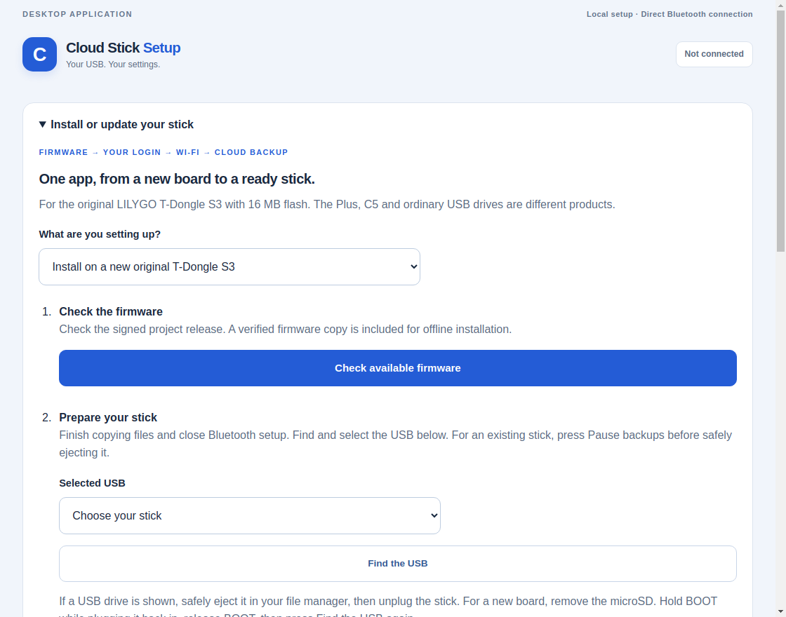

# One app for your stick

The **0.6.0 desktop preview** adds firmware installation to Cloud Stick Setup on
Windows and Linux. You can install a new supported stick, or update an existing
Cloud Stick, then continue to your login, Wi-Fi and cloud settings in the same app.

This preview's installer has software and simulated interruption checks. A first
installation on an unconfigured board and a physical Windows USB installation
still need testing. The owner is planning to buy a second board. The existing
stick has not been erased to imitate a new one.

## Which USB can I use?

Use the **original LILYGO T-Dongle S3 with 16 MB flash and no PSRAM**. The Plus,
C5 and ordinary USB flash drives are different products. The app checks the chip,
flash size, security settings and known firmware before it allows installation.
If it cannot identify the stick safely, it stops and explains the next step.

## Install a new original board

1. Open **Install or update your stick** and choose **Install on a new original
   T-Dongle S3**.
2. Press **Check available firmware**. The app checks the project's signed
   release. If the internet is unavailable, it can use the verified firmware
   included with the complete app installer.
3. Close any file copies. If a USB drive is shown, safely eject it in your file
   manager, then unplug the stick. Remove its microSD before a first installation.
4. Hold the board's **BOOT** button while plugging it back in. Release BOOT.
   Press **Find the USB** and select your stick.
5. Press **Review and install firmware**. Check the separate confirmation window
   and confirm the original board model. Keep the USB connected and the computer
   powered while recovery checks, installation and verification finish.
6. Press **Continue to login and Wi-Fi**. Find and check the USB in the setup
   wizard. Follow **Create my first account** to choose your username/password.
   Account creation has its own ten-second BOOT hold, followed by a sign-in check.
7. Continue through Wi-Fi and cloud settings, then press Finish and wait for
   Bluetooth to close. Safely eject any drive shown and unplug the stick. Insert
   the prepared microSD while unplugged, then reconnect normally. Your login and
   settings stay saved. Leave power connected and try a small test file.

The BOOT hold while plugging in starts firmware installation mode. The later
BOOT hold for creating your account is a separate step while normal firmware is
running. No default password is supplied, and an existing account cannot be
replaced through the new-board path.

## Update an existing Cloud Stick

Choose **Update my existing Cloud Stick**, check available firmware, then find
and select the normally running USB. Close Bluetooth setup and press **Pause
backups for update**. Wait for the app to confirm that work has stopped.

Safely eject and reconnect with BOOT held as above. Find the USB again, then
review and confirm the installation. Existing-stick updates replace only the
application firmware. The app checks that the login, saved Wi-Fi settings,
partition layout and internal backup records were preserved. The microSD is
never formatted or written by this installer.

If the stick already has the offered firmware, it reports that after checking
its identity, recovery copies and restart. It does not rewrite the same image.

## If something interrupts installation

Keep the USB connected and reopen Cloud Stick Setup. It reads the saved job;
it never starts another write automatically. If a write was interrupted, choose
**Review and resume interrupted install** only with the same stick in BOOT mode.
The app checks its recovery copies, target firmware and protected bytes first.
Changed settings, a different board or a damaged recovery copy block recovery.

If firmware bytes passed verification but normal startup could not be confirmed,
reconnect normally and use **Diagnose my stick**. Repeating installation is not
the way to clear a startup-review message.

Recovery copies are encrypted and stored privately on the computer. Keep that
computer and its recovery folder available until the stick is working. They
include private device settings; do not upload them to GitHub or attach them to
a public bug report. Windows protects the recovery key for your Windows account.
Linux requires a systemd desktop user session with working memory controls.

## What an update does automatically

The app can check/download a newer signed firmware release. **You still confirm
installation.** It never interrupts file copying, flashes silently or installs
a new version of the desktop app by itself. Saved Wi-Fi or cloud settings and a
verified firmware install do not prove that a file has uploaded. Check the
stick's recorded backup results for that.

## Technical review

The bounded catalog is signed with an embedded Ed25519 verification key. A local
manifest's own signature assertion grants no authority. Release URLs are limited
to this project's GitHub release assets, with TLS verification. ZIP membership,
sizes and SHA-256 identities are checked before use; the six initial image
segments have fixed reviewed offsets. A cached catalog revision cannot move
backward below the bundled/cached trusted revision.

The offered firmware remains **0.4.6-cache-dev**, from source
`adc439bcc69802d289fa79b34f9994f4093d0f83`, app SHA-256
`b0d5984282d5ed41f2dfa99558aca38aae8b865102d959de3ff61118228554a3`.
The existing partition-table SHA-256 remains
`35897a52e0d951707f219eb6292b945ad55095364e3a8075eeeb4b221e211798`.
No firmware source, SDK, watchdog, authentication or TLS policy changes are part
of the desktop updater.

The signed catalog v1 also authorizes the current strict STATUS/OWNER_STATUS,
Security2 and diagnostics wire contract for its known application versions. A
later compatible firmware can be installed and used without a hardcoded desktop
version-list change. Only a verified release-key signature extends native
admission; local manifest review and renderer arguments cannot. A breaking
management, partition or persistent-record contract requires a new catalog schema and setup app; an
old app reports that an app update is required before offering that firmware.

New-board installation admits erased flash or the pinned original manufacturer's
screen image, with no Cloud Stick ownership namespaces and an empty target
journal. Its six segments initialize only the reviewed bootloader/table,
NVS/OTA space, application and empty internal journal. The vendor binary is used
for recognition hashes and is not included. Unknown images and the Plus are not
silently admitted.

The empty `/queue` image is generated with littlefs-python 0.19.0 and mounted
read-only with the actual frozen SDK's LittleFS C sources by
[verify_empty_journal.c](../tools/verify_empty_journal.c). The SDK `lfs.c` SHA-256
is `a36d6a095785ddea9571d541d68d3e4ef01d5b255a99d17d3f07fb6ea60ea132`;
`lfs.h` is `b1befd7288d08815accc8f9af744c55686c0b9e3ac0061c32ceee38a1b3eb96d`.
The image SHA-256 is
`2853d81054fb721d2ecef4dd9c5b6185f1c9b9163605528d822afdad7a1c95f4`.

Before a write, two fresh full 16 MiB reads are encrypted separately, reopened,
authenticated and compared byte for byte. Independent full-flash read-back then
checks the expected image overlay and all protected bytes. Final sector padding
is preserved. ROM access uses explicit selected-device identity, exclusive
serial ownership, no reset during connection, no stub, no mass erase and no eFuse
writes. Both vendor whole-image and block-write retries are disabled. An uncertain
write is never retried automatically. Normal boot occurs only after verification.

The installer runs as an independent program with its preferred source and
notices beside it. A Linux systemd user service checks its actual cgroup swap
limit/current value are zero before reading private flash. Windows uses a
protected user/SYSTEM directory, DPAPI-wrapped recovery key and VirtualLock for
caller-owned private buffers. Python/crypto internal temporary copies are not
claimed to be locked on Windows. This is not a whole-process Windows no-swap
claim. Window close waits for active installation; a detached job can be observed
again after an unexpected UI exit. Windows process creation times prevent a
reused process number from being mistaken for that installer. Resume authenticates
the original board identity before reading the selected board for a new checkpoint.

Primary references: [Espressif's scripting API](https://docs.espressif.com/projects/esptool/en/latest/esp32s3/esptool/scripting.html),
[Espressif flash commands](https://docs.espressif.com/projects/esptool/en/latest/esp32s3/esptool/basic-commands.html),
[LILYGO's original-board quick start](https://wiki.lilygo.cc/products/t-dongle-series/t-dongle-s3/quick-start.html),
and [Microsoft VirtualLock](https://learn.microsoft.com/en-us/windows/win32/api/memoryapi/nf-memoryapi-virtuallock).
Preserve the [source and binary release gate](CREDITS.md); neither this design nor
CI resolves the retained upstream license-text gap.
