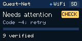

# See which Wi-Fi the stick is using

Development firmware **0.4.15-wifi-screen** shows the current Wi-Fi name at the
upper left of the stick's normal backup screen. You can see it while a file is
uploading, waiting or showing an error. The Wi-Fi indicator and SD status remain.

This image uses sample data and the actual renderer with pinned TFT font bitmaps.
It is a computer simulation, not a photograph or proof of a successful Guest-Net
internet connection. Physical screen acceptance is still pending.

The name comes from the connection the stick actually verified, including its
address from the network. Choosing or attempting a saved network does not make
its name appear as connected. After switching, the header follows the new
connection; when disconnected, it reads **Wi-Fi offline**. During setup and
Bluetooth management, the existing instruction screens retain their purpose.

The tiny header fits fourteen characters. Longer names end in `...`; characters
the built-in font cannot display appear as `?`. The network header never
displays a Wi-Fi password. This change adds no network names to the public web dashboard or USB diagnostic output.

## What this update does not establish

A Wi-Fi name shows the local connection, not internet or cloud verification.
The separate [Guest-Net test](https://github.com/rtariq2015/cloud-stick-pro/pull/32)
joined the open network and obtained an address, but internet access was not
verified. That temporary test did not save a new Wi-Fi profile.

The existing [cloud readback error](https://github.com/rtariq2015/cloud-stick-pro/issues/24)
remains open. Error `-4` means the HTTP client found its connection closed. A
read-only observation of the installed normal firmware found this after an
HTTP 200 response while reading the final cloud copy. It does not prove a guest
login page caused the failure, and this screen update does not fix that failure.

## Verification

Source: `e853bfd` on `feat/lcd-wifi-name`, based on the installed normal
0.4.14 runtime. USB storage, partitions, cloud transport, owner authentication,
BLE lifecycle and the saved-network policy retain their existing implementation.
The change reads the existing verified radio state and formats a bounded label.

Passing computer checks: LCD formatting with 100,000 model frames; the actual
LCD adapter with 10,000 varied frames and 26 synthetic preview panels; no C++
render allocations in the native mocked-renderer checks; ASan/UBSan checks;
169 historical, 204 release and 239 radio-diagnostic assertions; 78 owner-loop build/scenario checks; 62 frozen-build
guard self-tests; and the publication policy tests. Radio events, DHCP, the
TFT driver and storage handoffs are simulated in these native tests.

The exact target-build identity and hardware status are recorded below. A new
firmware installation still requires the owner's approval. The public update
feed and offered downloads have not changed.

## Exact target build

| Item | Verified result |
| --- | --- |
| Firmware candidate | `0.4.15-wifi-screen` |
| Source commit | `e853bfd7fffaae1f57170fa9f8d8763c17d9ba33` |
| PlatformIO environment | `tdongle_s3_product_upload_dev` |
| Application bytes | 1,705,056 |
| Application SHA-256 | `05082ad573cc562e374f80d654bee89854ba010572eb7d714d692b7a4156ea85` |
| Retained SDK | All 6,509 manifest entries verified before and after the build |
| Target compilation and ELF/image checks | Passed |
| Physical installation and screen check | Not performed for this candidate |

The private app image, ELF, map and build record were frozen separately from the
public source. The build retained the USB storage ownership, partition layout,
TLS verification and existing build safeguards. No device was flashed, reset,
ejected or reconfigured to implement this screen change. The earlier status
inspection used fixed read-only commands; it did not request a cloud transfer.

After an approved installation, check the header on the normal backup screen,
including while an error is showing. Compare it with the connected network in
authenticated Setup. A controlled network change and physical readability remain
separate hardware checks; do not treat the synthetic image as those checks.
