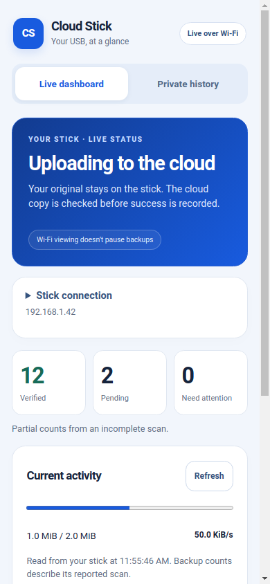

# Android Viewer 0.2.0 — live Wi-Fi dashboard

The Android app previously opened to Bluetooth sign-in even when a phone could
already show the stick’s dashboard in its browser. Version **0.2.0**, version
code **4**, opens to a live Wi-Fi dashboard and keeps private history separate.

## Install and use

Download **Cloud-Stick-Viewer-0.2.0.apk** from
[the Android dashboard preview](https://github.com/rtariq2015/cloud-stick-pro/releases/tag/preview-2026.11.08-android-dashboard).
Open it on your Android 12+ phone and choose **Update** for the existing app.
It uses the same application ID and signing identity as 0.1.2; no uninstall is
needed for a matching official installation. The APK is an Android update,
not firmware for the USB or a Windows/Linux installer.

Keep the phone and stick on the same reachable Wi-Fi or hotspot. Enter the IP
address shown on the stick—the same address that opens in your browser—and tap
**Save & connect**. Only that address is remembered on this phone. The next launch
opens the dashboard automatically. Change it under **Stick connection** if the
stick gets a new address, or choose **Forget address** to remove it.

The home screen shows current work, verified/pending/attention counts, transfer
progress, Wi-Fi, microSD, firmware and the last recorded verified backup. It reads
the existing public `/status` endpoint; it never loads remote pages or scripts.
Wi-Fi viewing does not pause backups. No login or owner key is sent over Wi-Fi.
An unavailable connection marks retained counts as old and hides transfer progress.
The app polls only while the dashboard is visible, with bounded retries.

Choose **Private history** for file names and saved receipts. That view still
needs BOOT, Bluetooth and your personal login; Bluetooth management pauses backups.
Returning to the live dashboard waits for native close acknowledgement. Backgrounding
clears private results and ends the Bluetooth session. The app saves no password.

## Scope and checks

- Firmware remains **0.4.6-cache-dev** and desktop Setup remains **0.6.0**. No
  dongle, cloud account or user file was touched by this Android task.
- Native Java tests cover private-address admission, fixed credential-free GET,
  exact response schema, unsigned counters, redirects, compression, wrong MIME,
  malformed/duplicate/private fields, body limits, truncation, cancellation,
  transport failure and a non-renewable slow-response deadline.
- JavaScript tests cover startup without Bluetooth/sign-in, saved/new/forgotten
  addresses, no overlapping polls, stale/offline readings, background cancellation,
  late initialization/results, private-view handoff and failed Bluetooth closure.
  Existing authentication and GATT tests remain in the suite.
- **48 Java tests and 57 JavaScript tests pass.** The actual-asset synthetic
  renderer passes **56 checks** at 390/320 px.
- Release compilation, Android lint and synthetic rendering at 390/320 px are
  separate software checks. Exact counts, source and APK hashes are in the release’s
  validation and checksum files. The images use public injected fixtures; they
  do not show a real radio, phone, dongle or cloud test.
- Android lint retains the existing JavaScript-enabled WebView warning and two
  unused-but-required notice-resource warnings. No lint error is suppressed.

**Physical acceptance is pending:** installation of this exact APK on a phone,
actual saved-address persistence, phone-to-stick Wi-Fi/hotspot access, network
switch/address change, Android background/resume and Bluetooth/private-history
round trip. A successful build does not establish these results. The owner’s
preceding “it worked” report is useful user feedback, but does not identify a
network power-off sequence or independently verify this new APK.

## Security and provenance

The new native reader accepts only a selected canonical RFC1918 IPv4 address and
`GET /status` on port 80. It bypasses proxies, refuses redirects/compression,
limits responses to 4 KiB, validates the exact public schema, and enforces finite
connect/read/total deadlines. Work is bounded and stale generations are discarded.

Android now needs INTERNET permission and cleartext capability for the existing
local HTTP dashboard. That capability is app-wide; the fixed native endpoint and
unchanged WebView asset/navigation/interception/CSP policy remain essential.
The renderer still has no network access. No TLS bypass, cloud API, remote script,
external browser launch, analytics or network scan is added. Local status is
public and unauthenticated, not an independent proof of the cloud contents.
Private history retains authenticated Security 2. The GATT driver, session policy
and shared cryptographic/protocol modules are unchanged.

The app retains backup/transfer exclusions, screenshot protection, notices and
original attribution. Signing keys, saved addresses, passwords and device logs are
excluded from source and release packages. See [Credits](../CREDITS.md) for the
unresolved upstream license-text gap and component notices. New dashboard-only
source carries a scoped MIT notice; it does not relicense inherited code.

Primary platform references: [Android network security configuration](https://developer.android.com/privacy-and-security/security-config)
and [local-network permission behavior](https://developer.android.com/privacy-and-security/local-network-permission).
These explain platform capabilities; they are not physical test evidence.
